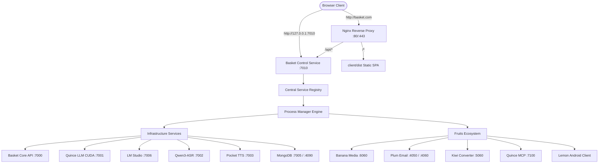

<div align="center">
  

  # Basket

  **Complete Local Operations Control Center & Fruits Ecosystem Operations Dashboard**

  *The central nervous system and unified operations cockpit for the Fruits ecosystem. Eliminates manual terminal operations by providing independent instance management, one-click aggregate workflows, live Azeret Mono log streaming, real reverse-proxy route monitoring, and Windows Task Scheduler integration.*

  <br />

  [](https://www.typescriptlang.org/)
  [](https://react.dev/)
  [](https://tailwindcss.com/)
  [](https://fastapi.tiangolo.com/)
  [](https://python.org/)
  [](https://nginx.org/)
  [](#-backend-security--local-first-guarantee)
  [](LICENSE)

  <br />

  <p align="center">
    <a href="#-overview">Overview</a> •
    <a href="#-architecture--dashboard-urls">Dashboard URLs</a> •
    <a href="#-central-service-registry">Service Registry</a> •
    <a href="#-management-scripts-bat-system">BAT Scripts</a> •
    <a href="#-fruits-ecosystem-directory">Fruits Ecosystem</a> •
    <a href="#-nginx-reverse-proxy-routes">Nginx & Routes</a> •
    <a href="#-windows-task-scheduler--logging">Task Scheduler & Logs</a> •
    <a href="#-getting-started">Getting Started</a>
  </p>
</div>

---

## 🌟 Overview

**Basket** is the root project and central command center for the entire **Fruits ecosystem** (Banana, Plum, Kiwi, Quince, and Lemon). 

Previously, managing backends, Vite servers, AI models (llama.cpp, LM Studio), voice speech runtimes (Qwen3-ASR, Pocket TTS), MongoDB databases, and Nginx required opening dozens of cmd windows, navigating directories, running fragmented `.bat` files, or executing broad `taskkill` commands that frequently terminated unrelated background processes.

Basket replaces this fragmented workflow with a unified **Apple-grade desktop operations application** adhering strictly to the *Quiet Utility* design language:

* 🎛️ **Granular Process Lifecycle** — Start, restart, and end individual instances (e.g. restart only Quince LLM without disrupting STT, TTS, MongoDB, or Banana).
* 🌐 **Complete Aggregate Workflows** — Safely start, restart, or shut down all managed instances across the entire ecosystem in strict dependency order.
* 📜 **Live Azerbaijan/Azeret Mono Logs** — Inspect colored, collapsible, real-time log streams directly inside the web client with pause/resume, search filtering, and line limits.
* 🚦 **Real Route Verification** — Active health checks distinguishing whether a process is running, whether reverse proxies respond, and whether upstream routes are reachable.
* 🛡️ **Verifiable Process Identities** — Eliminates dangerous `taskkill /IM python.exe` by tracking PID, process creation timestamp, verified parent-child process trees, and listening ports.
* 🚪 **Nginx First-Class Controls** — Validate syntax (`nginx -t`), reload configurations (`nginx -s reload`), and monitor ports 80 and 443 directly from the dashboard.

---

## 🌐 Architecture & Dashboard URLs

Basket provides both a dedicated local control service and full reverse-proxy integration via Nginx:

| Interface | URL | Destination | Role |
|---|---|---|---|
| **Local Direct Dashboard** | `http://127.0.0.1:7010` | Basket Control API & Client | Direct access bypassing reverse proxy |
| **Hosted Nginx Dashboard** | `http://basket.com` | `client/dist` & `127.0.0.1:7010/api` | Primary browser URL (HTTP) |
| **Hosted SSL Dashboard** | `https://basket.com` | `client/dist` & `127.0.0.1:7010/api` | Primary browser URL (HTTPS / SSL) |
| **Basket Core API** | `http://api.basket.com` | `127.0.0.1:7000` | Core FastAPI backend (preserved) |
| **Basket Core Direct** | `http://127.0.0.1:7000` | `src.main:app` | Direct FastAPI API |



---

## 📋 Central Service Registry

Every managed process is declared once in `src/control/registry.py` with verified parameters, health check strategies, and process-matching signatures:

| Service ID | Instance Name | Category | Host & Port | Start Command | Health Strategy | Task Scheduler |
|---|---|---|---|---|---|---|
| `basket-control` | Basket Operations Dashboard | Control | `127.0.0.1:7010` | `python run_control.py` | HTTP `GET /api/health` | — |
| `basket-api` | Basket Core API Gateway | Infrastructure | `127.0.0.1:7000` | `python run.py` | HTTP `GET /docs` | `Basket Server` |
| `nginx` | Nginx Reverse Proxy | Proxy | `127.0.0.1:80,443` | `Start Enginx` | HTTP `GET /` | `Start Enginx` |
| `mongodb` | Basket MongoDB | Database | `127.0.0.1:7005` | `mongod --port 7005` | TCP Port `7005` | — |
| `llm-llama` | Quince LLM (llama.cpp) | LLM | `127.0.0.1:7001` | `llama-server.exe (CUDA)` | HTTP `GET /health` | — |
| `lms` | LM Studio Server | LLM | `127.0.0.1:7006` | `lms server start` | TCP Port `7006` | `LMS Server Start` |
| `stt-qwen` | Qwen3-ASR Speech-to-Text | Speech | `127.0.0.1:7002` | `llama-server.exe (CPU)` | HTTP `GET /health` | — |
| `tts-pocket` | Pocket TTS | Speech | `127.0.0.1:7003` | `pocket-tts serve` | TCP Port `7003` | — |
| `fruit-banana` | Banana Media Utility | Fruit | `127.0.0.3:6060` | `python run.py` | HTTP `GET /docs` | `Banana Backend` |
| `fruit-plum-backend` | Plum Email Server | Fruit | `127.0.0.2:4050,4065` | `node dist/index.js` | TCP Port `4050` | — |
| `fruit-plum-frontend` | Plum Client Dev Server | Fruit | `127.0.0.2:4060` | `vite --port 4060` | HTTP `GET /` | — |
| `fruit-plum-mongo` | Plum Dedicated MongoDB | Database | `127.0.0.1:4090` | `mongod --port 4090` | TCP Port `4090` | — |
| `fruit-kiwi` | Kiwi File Converter | Fruit | `127.0.0.4:5060` | `python run.py` | HTTP `GET /docs` | `Kiwi Backend` |
| `fruit-quince` | Quince Assistant MCP | Fruit | `127.0.0.1:7100` | `python run_mcp.py` | TCP Port `7100` | — |
| `fruit-lemon` | Lemon Android App | Fruit | Mobile Device | Android APK | Native System | — |

> [!NOTE]
> **SearXNG Decommissioning**: SearXNG has been decommissioned from active infrastructure. Its virtual host, routes, aggregate startup integration, and monitoring have been safely removed while retaining all historical persistent data.

---

## 🛠️ Management Scripts (BAT System)

A complete, 39-script orchestration system is organised in `infrastructure/`. Every service, fruit, and Basket itself has its own trio of scripts (`start.bat`, `restart.bat`, `end.bat`):

```text
infrastructure/
├── [Original preserved scripts: config.bat, start.bat, stop.bat, restart.bat, status.bat]
│
├── logs/                         <-- Per-instance persistent UTF-8 logs
├── run/                          <-- Verified PID records & operations.json
│
├── all/                          <-- Full Ecosystem Orchestration
│   ├── start.bat
│   ├── restart.bat
│   └── end.bat
│
├── basket/                       <-- Basket API Gateway
│   ├── start.bat
│   ├── restart.bat
│   └── end.bat
│
├── nginx/                        <-- Nginx Edge Reverse Proxy
│   ├── start.bat
│   ├── restart.bat
│   └── end.bat
│
├── mongodb/                      <-- Core Basket MongoDB Database
│   ├── start.bat
│   ├── restart.bat
│   └── end.bat
│
├── llama/                        <-- Quince LLM (llama.cpp CUDA)
│   ├── start.bat
│   ├── restart.bat
│   └── end.bat
│
├── lms/                          <-- LM Studio Local Server
│   ├── start.bat
│   ├── restart.bat
│   └── end.bat
│
├── stt/                          <-- Qwen3-ASR Speech-to-Text
│   ├── start.bat
│   ├── restart.bat
│   └── end.bat
│
├── tts/                          <-- Pocket TTS Text-to-Speech
│   ├── start.bat
│   ├── restart.bat
│   └── end.bat
│
└── fruits/
    ├── banana/                   <-- Banana Media Utility
    │   ├── start.bat
    │   ├── restart.bat
    │   └── end.bat
    ├── plum/                     <-- Plum Email Assistant (Server, Client & Mongo)
    │   ├── start.bat
    │   ├── restart.bat
    │   └── end.bat
    ├── kiwi/                     <-- Kiwi File Converter
    │   ├── start.bat
    │   ├── restart.bat
    │   └── end.bat
    ├── quince/                   <-- Quince Local Voice Runtime & MCP Server
    │   ├── start.bat
    │   ├── restart.bat
    │   └── end.bat
    └── lemon/                    <-- Lemon Android Client (Status reporting)
        ├── start.bat
        ├── restart.bat
        └── end.bat
```

### Script Execution Features
* **Safe Target Isolation**: Executing `infrastructure/llama/restart.bat` restarts Quince LLM without terminating STT, TTS, MongoDB, or Nginx.
* **Interactive vs Automated**: Scripts pause when double-clicked in Windows Explorer, but exit cleanly without pausing when passed `/nopause` or when `BASKET_NO_PAUSE=1` is set.
* **Exit Codes**: Standard exit codes (`0` for verified success, `1` for error) allow scripts to be embedded into external CI or scheduled tasks.

---

## 🍓 Fruits Ecosystem Directory

The dashboard showcases every fruit using its genuine branding and highlights its operational state:

| Fruit | Application Type | Logo Source | Browser Route | Upstream Destination | Redirector Status |
|---|---|---|---|---|---|
| **Banana** | Media Downloader & Audio Trimmer | `banana-icon.svg` | `https://banana.com` | `fruits/banana/client/dist` (API: `127.0.0.3:6060`) | Active Web Gateway |
| **Plum** | Personal Intelligent Email Client | `plum-icon.svg` | `https://plum.com` | `127.0.0.2:4060` (API: `127.0.0.2:4050`, WS: `4065`) | Active Web Gateway |
| **Kiwi** | Offline File & Format Converter | `kiwi-icon.svg` | `https://kiwi.com` | `fruits/kiwi/client/dist` (API: `127.0.0.4:5060`) | Active Web Gateway |
| **Quince** | Windows AI Runtime & System MCP | Stylized Letter Mark | None | `stdio / 127.0.0.1:7100` | **No Redirector** (System Assistant) |
| **Lemon** | Private Android DNS Workspace | `lemon-icon.png` | None | Mobile TUN Loopback | **No Redirector** (Android Client) |
| **Cherry** | Ecosystem Workspace Module | `basket-icon.svg` | None | Local Workspace | Initialized |

---

## 🌐 Nginx Reverse-Proxy Routes

Basket configures and manages the edge reverse proxy hosted in `C:\nginx`:

```nginx
# Basket Operations Dashboard
server {
    listen 80;
    server_name basket.com;
    root C:/Users/ADMIN/OneDrive/CODES/Projects/Projects/Basket/client/dist;
    index index.html;
    location /api/ {
        proxy_pass http://127.0.0.1:7010/api/;
    }
    location / {
        try_files $uri $uri/ /index.html;
    }
}
```

* **Hosts Entry**: Ensure `127.0.0.1 basket.com` exists in `C:\Windows\System32\drivers\etc\hosts`.
* **Zero CORS**: Because the dashboard web app and its control API are served under the same origin via both `http://basket.com` and `http://127.0.0.1:7010`, requests execute with zero CORS overhead or mixed-content errors.

---

## ⏰ Windows Task Scheduler & Logging

Basket natively integrates with processes launched at Windows boot via Task Scheduler:

* **Discovered Tasks**:
  * `Start Enginx` (`C:\nginx\run-enginx.bat`) — Runs with highest elevation to manage port 80/443.
  * `Banana Backend` (`C:\Basket\Banana\start-server.bat`) — Launches Banana FastAPI server.
  * `Kiwi Backend` (`C:\Kiwi\start-backend.bat`) — Launches Kiwi FastAPI converter.
  * `LMS Server Start` (`C:\Basket\lms-server-start.bat`) — Launches LM Studio server.
  * `Basket Server` (`infrastructure\start.bat`) — Launches Basket core.
* **Persistent Logging**:
  * All stdout and stderr streams are redirected to `infrastructure/logs/<service_id>.log`.
  * Logs preserve original timestamps and UTF-8 encoding.
  * Rendered inside the client using local **Azeret Mono** variable fonts with syntax-aware color tagging (errors in rose red, warnings in amber, status messages in emerald).

---

## 🚀 Getting Started

### 1. Prerequisites
* Windows 10/11
* Python 3.10+ (located in workspace `.venv`)
* Node.js v18+ & npm (for building the client)
* Nginx installed at `C:\nginx`

### 2. Build the Operations Client
```powershell
cd client
npm install
npm run build
```
*(Builds static production assets directly into `client/dist/`)*

### 3. Start Basket Operations Control
```powershell
# Directly via Python:
.\.venv\Scripts\python.exe run_control.py

# Or via the new management script:
.\infrastructure\basket\start.bat
```

### 4. Access the Dashboard
Open your browser and navigate to:
* **`http://127.0.0.1:7010`**
* **`http://basket.com`** (or `https://basket.com`)

---

## 🔒 Security & Local-First Guarantee

* **Localhost Binding**: The Basket Control API binds strictly to `127.0.0.1` and never binds to public interfaces (`0.0.0.0`).
* **Allowlisted Operations**: The API accepts only validated service IDs and predefined operation verbs (`start`, `restart`, `end`). Arbitrary shell execution or path traversal is strictly prohibited.
* **No Telemetry**: Basket operates 100% offline with zero cloud telemetry, tracking pixels, or remote dependencies.
