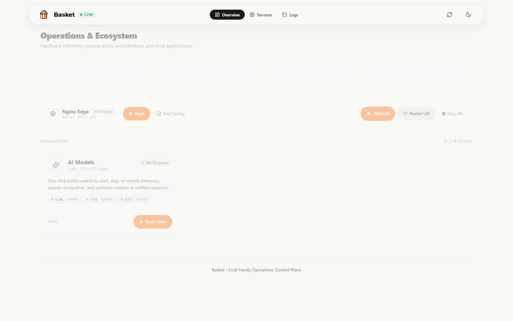
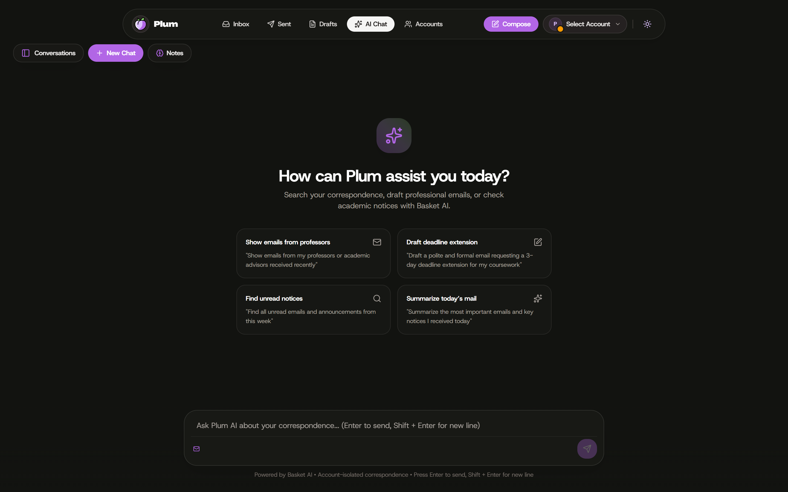
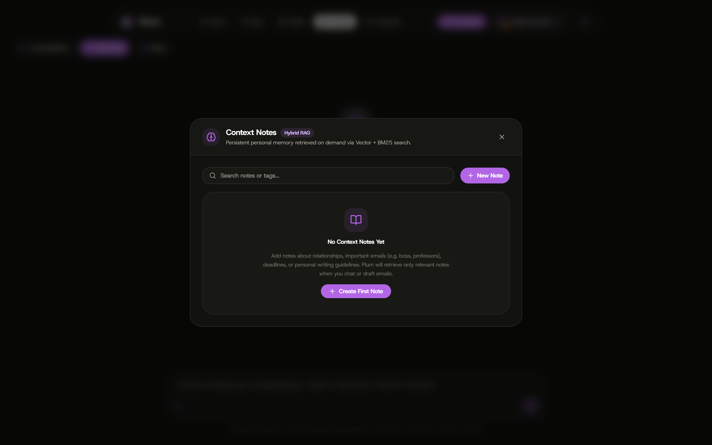
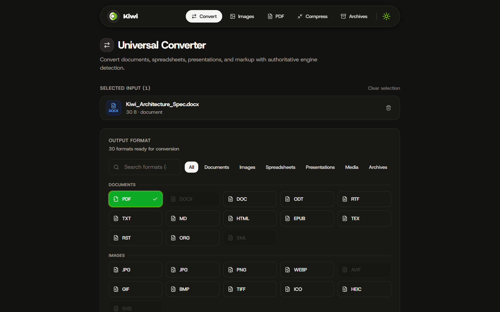
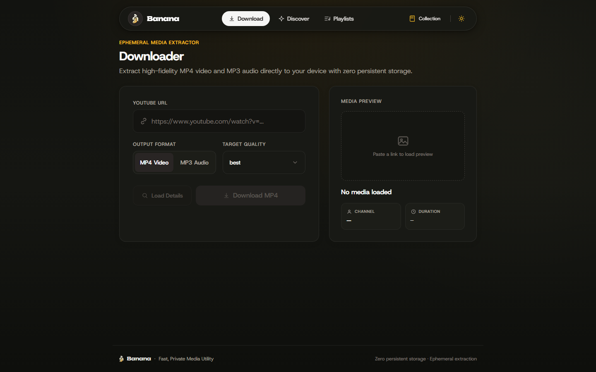

<div align="center">

  

  # Basket

  **The Central Operations Cockpit, Real-Time AI Inference Hub & Context Engine for the Fruits Ecosystem.**

  A high-performance, local-first control plane orchestrating distributed AI runtimes, multi-tenant hybrid RAG, sub-second streaming voice synthesis, isolated loopback networking, and verifiable process trees.

  <p align="center">
    <a href="#core-architectures"></a>
    <a href="#architecture-1-3-tier-context--knowledge-engine"></a>
    <a href="#architecture-2-hybrid-rag--reciprocal-rank-fusion-rrf"></a>
    <a href="#architecture-3-sub-second-streaming-voice--agentic-pipeline"></a>
    <a href="#getting-started"></a>
    <a href="#getting-started"></a>
    <a href="#architecture-4-loopback-subnet--edge-reverse-proxy-topology"></a>
    <a href="#license"></a>
  </p>

  <p align="center">
    <a href="#why-basket">Why Basket</a> •
    <a href="#visual-tour--ecosystem-cockpit">Visual Tour</a> •
    <a href="#core-architectures">Core Architectures</a> •
    <a href="#central-service-registry">Service Registry</a> •
    <a href="#fruits-ecosystem-directory">Fruits Ecosystem</a> •
    <a href="#rest--websocket-api-reference">API Reference</a> •
    <a href="#management-scripts-bat-system">BAT Orchestration</a> •
    <a href="#getting-started">Getting Started</a>
  </p>

</div>

---

<div align="center">
  
  <p><em>Desktop Operations Cockpit: Hardware telemetry HUD, aggregate dependency workflows, verifiable process trees, and edge route matrix.</em></p>
</div>

---

## Why Basket?

Running a modern suite of local-first autonomous applications (Banana, Plum, Kiwi, Quince, Lemon, and Cherry) alongside local LLMs, Speech-to-Text (STT), Text-to-Speech (TTS), and databases typically descends into operational chaos:

* **Fragmented CLI Workflows**: Juggling dozens of detached terminal windows for `llama-server.exe`, `lms`, `mongod`, Vite dev servers, and FastAPI gateways.
* **Unsafe Process Termination**: Executing blunt `taskkill /IM python.exe` commands that inadvertently terminate IDE language servers, build watchers, and background worker scripts.
* **Monolithic Context Degradation**: Dumping active conversation history, reference documentation, and strict behavioral guidelines into a single vector database—causing prompt instructions to be filtered out because they were not "semantically similar" to the user prompt.
* **Audio Stutter in Voice AI**: Chaining LLM token output directly to speech synthesis, leading to either robotic cadence or 3-second Time-to-First-Audio (TTFA) latency.
* **Port Collisions and Cross-Origin Latency**: Fragile port mapping, mixed-content errors, and continuous CORS configuration overhead across local services.

### The Solution

* **Deterministic Process Tree Management**: Verifies process creation timestamps, executable paths, parent-child process lineages, and active socket binds before executing any lifecycle action.
* **3-Tier Context and Knowledge Lifecycle**: Separates ephemeral multi-turn conversations ($O(1)$ switch), persistent hybrid knowledge (RRF $k=60$), and unconditional in-memory system guardrails.
* **Adaptive Sub-Second Voice Streaming**: Custom boundary-aware `TextChunker` that delivers accelerated first-chunk audio (24–110 chars) while preserving linguistic prosody and acoustic boundaries.
* **Isolated Loopback IP Subnetting**: Maps ecosystem services to private loopback aliases (`127.0.0.1` through `127.0.0.7`) under Nginx edge routing with zero-CORS unified origins.
* **Strict Local-First Architecture**: Binds strictly to `127.0.0.X` interfaces, zero third-party telemetry, zero external cloud dependencies, and zero data leakage.

---

## Visual Tour & Ecosystem Cockpit

### 1. Operations Cockpit & Hardware Telemetry
> Unified desktop cockpit delivering real-time CPU/RAM/VRAM telemetry, one-click aggregate workflows, and route verification.

<div align="center">
  
</div>

* **Granular vs Aggregate Control**: Start, restart, or safely shut down individual microservices or trigger sequenced dependency bootups (`Database -> LLM -> Speech -> Edge -> Frontends`).
* **Active Health Verifiers**: Continuous HTTP/TCP probes distinguishing whether a process is running, whether Nginx responds, and whether upstream handlers are reachable.
* **Persistent Azeret Mono Logs**: Real-time multi-service stdout/stderr streaming with syntax highlighting, line filtering, and freeze controls.

---

### 2. Conversational Multi-Chat & Assistant Intelligence (Plum)
> Production-grade intelligent personal assistant showcasing Basket's 3-Tier Context Engine and hybrid retrieval.

<div align="center">
  
</div>

* **Lazy Context Bootstrapping**: Switches active conversation sessions in $<20\text{ms}$ by purging and bootstrapping volatile vector memory from MongoDB in a single atomic pass.
* **Progressive Turn Indexing**: $O(1)$ concurrent batch-embedding of user and assistant responses to preserve instant short-term recall.
* **Unconditional Guardrails**: Always guarantees that personal formatting rules and system constraints are followed without vector drift.

---

### 3. Persistent Knowledge Base & Real-Time Sync
> Long-term document storage, facts, and policy reference indexed across both vector and lexical search spaces.

<div align="center">
  
</div>

* **Incremental Mutation Webhooks**: Real-time REST webhooks (`POST /context/notes/sync`) instantly update or delete dense and sparse chunks with zero full-rebuild lag.
* **Cross-Fruit Shared Memory**: Fruit applications can query persistent cross-domain knowledge while strictly isolating private namespaces.

---

### 4. Autonomous Fruit Workspaces (Kiwi & Banana)
<div align="center">
  <table>
    <tr>
      <td width="50%" align="center">
        <b>Kiwi: Offline File & Conversion Studio</b><br />
        
        <br />
        <em>Local document, audio, video, and archive format conversion with admission control backpressure.</em>
      </td>
      <td width="50%" align="center">
        <b>Banana: Private Media & Discovery Utility</b><br />
        
        <br />
        <em>Offline audio trimming, media extraction, and algorithmic music similarity clustering.</em>
      </td>
    </tr>
  </table>
</div>

---

## Core Architectures

Basket is engineered around **7 distinct production architectures** that ensure resilience, low latency, and zero context degradation.

```
+-------------------------------------------------------------------------------------------------------+
|                                        BASKET ECOSYSTEM TOPOLOGY                                      |
+-------------------------------------------------------------------------------------------------------+
                                                     |
                                   HTTPS (*.jam / *.com) :80, :443
                                                     v
                                  +------------------------------------+
                                  |      Nginx Edge Reverse Proxy      |
                                  +------------------+-----------------+
                                                     |
             +--------------------+------------------+-------------------+--------------------+
             |                    |                                      |                    |
             v                    v                                      v                    v
     [ 127.0.0.1:10020 ]  [ 127.0.0.1:10010 ]                    [ 127.0.0.2:10000 ]  [ 127.0.0.3:10000 ]
     Basket Control UI    Basket Core API Gateway                Plum Email Client    Kiwi Converter
             |                    |                                      |                    |
             |                    +------------------+-------------------+                    |
             |                                       |                                        |
             v                                       v                                        v
   +--------------------+               +--------------------------+             +--------------------+
   |  Process Manager   |               |   3-Tier Context Engine  |             | External Binaries  |
   |  • Safe Tree Kill  |               |   • Volatile Chats       |             | • FFmpeg           |
   |  • Task Scheduler  |               |   • Persistent Notes     |             | • LibreOffice      |
   |  • UTF-8 Logs      |               |   • Stitched Commands    |             | • Ghostscript      |
   +--------------------+               +-------------+------------+             +--------------------+
                                                      |
                         +----------------------------+---------------------------+
                         |                                                        |
                         v                                                        v
           +---------------------------+                            +---------------------------+
           |    Hybrid RAG Engine      |                            |   Streaming Voice Loop    |
           | • ChromaDB (Dense Vector) |                            | • Qwen3-ASR (STT Engine)  |
           | • BM25Okapi (Sparse Lex)  |                            | • Adaptive Text Chunker   |
           | • Reciprocal Rank Fusion  |                            | • PocketTTS 24kHz PCM     |
           | • Cross-Encoder Reranker  |                            | • MCP Tool Calling Loop   |
           +---------------------------+                            +---------------------------+
```

---

### Architecture 1: 3-Tier Context & Knowledge Engine

The fundamental limitation of naive RAG systems is treating all context equally. In Basket, context is separated into **three distinct architectural tiers** based on lifespan, update velocity, and retrieval priority (`src/services/context/tiered_context.py`):

```
                                  Incoming User Prompt / Completion
                                                  |
                    +-----------------------------+-----------------------------+
                    |                             |                             |
                    v                             v                             v
       [ TIER 1: Volatile Chat ]     [ TIER 2: Persistent Notes ]      [ TIER 3: Commands ]
       • Active Session Messages     • Long-Term Knowledge Base        • Persona & Guardrails
       • Volatile ChromaDB + BM25    • Persistent ChromaDB + BM25      • High-Speed Memory Cache
       • Purged on Chat Switch       • Real-time Webhook Sync          • Zero Vector Search
       • Progressive O(1) Append     • Cross-Session Retention         • Unconditional Injection
                    |                             |                             |
                    v (Weight: 0.7)               v (Weight: 0.3)               v (Weight: Absolute)
            [ Top 4 Chunks ]              [ Top 3 Chunks ]              [ <SYSTEM_COMMANDS> ]
                    |                             |                             |
                    +-----------------------------+-----------------------------+
                                                  |
                                                  v
                               +-------------------------------------+
                               | Stitched LLM System / User Payload  |
                               +-------------------------------------+
```

| Dimension | Tier 1: Volatile Chat | Tier 2: Persistent Notes | Tier 3: Stitched Commands |
|---|---|---|---|
| **Primary Scope** | Active conversation session | Permanent knowledge base & docs | Behavioral constraints & rules |
| **Storage Engine** | `volatile_chats` (ChromaDB + BM25) | `persistent_notes` (ChromaDB + BM25)| In-memory cache (`_commands_cache`)|
| **Persistence Source**| MongoDB `<fruit>.chats` | MongoDB `<fruit>.notes` | MongoDB `<fruit>.commands` |
| **Retention Policy** | Purged upon session switch | Permanent across all sessions | Permanent system-wide |
| **Indexing Strategy** | $O(1)$ batch append per turn | Incremental webhook sync | Direct cache insertion |
| **Retrieval Weight** | **Highest ($W=0.7$)** | **Secondary ($W=0.3$)** | **Absolute (Unconditional)** |
| **Search Mechanism** | Reciprocal Rank Fusion ($k=60$) | Reciprocal Rank Fusion ($k=60$) | **None** (Stitched verbatim) |

#### Why Tier 3 Bypasses Vector Search Entirely
Standard RAG fails when instructions like *"Always format output as ISO 8601"* are stored as vector chunks. When a user asks *"What was my last invoice amount?"*, cosine similarity calculates near-zero relevance for the date formatting rule and drops it. 
Basket eliminates this failure mode: **Tier 3 commands bypass vector similarity completely** and are stitched unconditionally into `<SYSTEM_COMMANDS>` headers on every turn.

---

### Architecture 2: Hybrid RAG & Reciprocal Rank Fusion (RRF)

To ensure maximum recall across both conceptual semantics and exact keyword matches (e.g., error codes, function names, IDs), Basket couples dense vector search with sparse lexical matching (`src/services/retrieval/chat_retriever.py`):

1. **Dense Semantic Retrieval**: Powered by `jinaai/jina-embeddings-v5-text-nano` generating 512-dimensional vector representations stored in ChromaDB.
2. **Sparse Lexical Retrieval**: Custom in-memory `BM25Okapi` search engine indexing tokenized n-grams.
3. **Reciprocal Rank Fusion (RRF)**: Instead of naively adding cosine similarities to unbounded BM25 scores (which skews ranking), Basket applies rank-based fusion with a smoothing constant $k=60$:

$$\text{RRF Score}(d) = \sum_{m \in \{\text{vector}, \text{bm25}\}} \frac{W_m}{k + \text{Rank}_m(d)}$$

Where:
* $W_{\text{vector}} = 0.6$, $W_{\text{bm25}} = 0.4$ for volatile chat candidates.
* $W_{\text{vector}} = 0.5$, $W_{\text{bm25}} = 0.5$ for persistent knowledge notes.
4. **Optional Neural Reranking**: Re-scores top fused candidates with a local Cross-Encoder (`cross-encoder/ettin-reranker-32m-v1`) before final context assembly.

---

### Architecture 3: Sub-Second Streaming Voice & Agentic Pipeline

Basket's voice assistant architecture (`src/services/chat/chat_pipeline.py`) eliminates conversational lag through an event-driven streaming pipeline:

```
[ Microphone Input ] 
         │ 
         ▼
[ Qwen3-ASR (Speech-to-Text :10040) ]
         │ Text Stream
         ▼
[ Autonomous Agent & MCP Loop ] ──Tool Call──> [ Quince MCP Tools (:10010) ]
         │                                               │
         │ Tokens                                  Tool Execution Result
         ▼                                               │
[ Streaming LLM (llama.cpp / LM Studio :10030) ] <───────┘
         │
         ▼
┌────────────────────────────────────────────────────────┐
│               Adaptive TextChunker Engine              │
│  • Hard boundaries: ['.', '?', '!', '\n']              │
│  • Soft boundaries: [',', ';', ':']                    │
│  • First chunk acceleration: 24–110 characters         │
│  • Subsequent phrase target: 190–320 characters        │
│  • Non-terminal period heuristic (e.g., 'v1.2', 'Dr.') │
└──────────────────────────┬─────────────────────────────┘
                           │ Balanced Sentences / Phrases
                           ▼
[ PocketTTS / Kokoro Neural Synthesis Engine (:10050) ]
                           │
                           ▼
[ Raw 24kHz 16-Bit Mono PCM Stream via Server-Sent Events / WebSocket ]
```

* **Accelerated First-Chunk Delivery**: The chunker releases the first phonetic block after only 24–110 characters, achieving a sub-500ms Time-to-First-Audio (TTFA).
* **Prosody Protection**: Subsequent chunks wait for soft/hard punctuation boundaries (190+ chars) so the TTS engine has adequate phonetic context for natural inflection and breathing pauses.

---

### Architecture 4: Loopback Subnet & Edge Reverse-Proxy Topology

To prevent port collisions and eliminate browser CORS pre-flight latency, Basket implements an edge reverse-proxy topology on Windows loopback IP aliases (`127.0.0.X`):

```
                        User Browser / Client
                                  │
                 https://basket.jam / https://plum.jam
                                  │
                        [ Nginx Edge Proxy ]
                                  │
      ┌───────────────────────────┼───────────────────────────┐
      │                           │                           │
127.0.0.1:10010             127.0.0.2:10000             127.0.0.3:10000
Basket Core API             Plum Web App                Kiwi File Converter
      │                           │                           │
127.0.0.1:10020             127.0.0.2:10010             127.0.0.4:10000
Basket Control              Plum WebSocket              Banana Media
```

* **Single Origin Guarantee**: By hosting the client single-page application and its backing API under unified Nginx host blocks (`http://basket.jam/api/*`), API requests execute with zero CORS overhead and zero mixed-content warnings.
* **Shared Ecosystem Static Assets**: Standardized brand assets, SVG icons, and typefaces are centralized in `Basket/assets` and mounted across all virtual hosts.

---

### Architecture 5: Operations Control Plane & Process Manager

Standard process killing scripts rely on generic executable names (`taskkill /F /IM python.exe`), which catastrophically terminate unrelated processes. Basket's Process Manager (`src/control/process_manager.py`) guarantees **verifiable process identity**:

* **Four-Factor Process Verification**:
  1. `Process ID (PID)`
  2. `Creation Timestamp (create_time)`
  3. `Verified Parent-Child Tree Topology`
  4. `Active TCP Port Listeners (via psutil)`
* **Tree-Aware Graceful Teardown**: Automatically traces child worker processes (e.g., Uvicorn workers, spawned FFmpeg jobs) and issues graceful `SIGTERM` signals before falling back to isolated tree termination.
* **Windows Task Scheduler Integration**: Directly coordinates with elevated boot tasks (`Start Enginx`, `Banana Backend`, `Kiwi Backend`, `LMS Server Start`).

---

### Architecture 6: Multi-Tenant Database Namespace Isolation

Basket coordinates a central, high-performance MongoDB instance (`mongodb://127.0.0.1:10000/`) structured by application namespaces:

```
mongodb://127.0.0.1:10000/
├── basket/      <-- Central orchestration metadata & operations history
├── plum/        <-- Plum Email Assistant namespace
│   ├── chats    <-- Multi-chat session threads (user & assistant turns)
│   ├── notes    <-- Persistent knowledge base & policies
│   └── commands <-- Stitched system prompt rules
├── kiwi/        <-- Kiwi Converter namespace (conversion records & preferences)
├── banana/      <-- Banana Media namespace (audio catalog & playlists)
├── quince/      <-- Quince Desktop Assistant namespace (MCP records & activity logs)
├── lemon/       <-- Lemon Network Guardian namespace (DNS rules & loopback tunnels)
└── cherry/      <-- Cherry Productivity namespace (sessions & accountability tasks)
```

Every conversational application adheres to the strict **3-collection contract** (`chats`, `notes`, `commands`), enabling seamless plug-and-play onboarding for future applications.

---

### Architecture 7: Fruit Family Design System ("Quiet Utility")

The visual interface across all Fruit web clients, Android apps, and dashboards adheres to the **Quiet Utility** design system (`docs/DESIGN.md`):

* **Apple-Grade Optical Glass**: Strict mathematical formulations for blur (`10px`–`15px`), saturation multipliers (`140%`–`160%`), and hairline interior edge highlights (`inset 0 1px 1px rgba(255,255,255,0.7)`).
* **Deterministic OKLCH Accent Derivation**: Accent color palettes are algorithmically extracted from each fruit's SVG icon in OKLCH color space to guarantee WCAG AA 4.5:1 contrast without arbitrary hex hardcoding.
* **Compositor-Only 120fps Rendering**: Animate strictly GPU-accelerated compositing properties (`transform`, `opacity`) with zero layout reflow triggers on high-refresh displays.
* **Tactile Audio SFX Engine**: Embedded HTML5 sound pool providing auditory feedback (`enter`, `back`, `notification`, `scroll`) throttled at 140ms with silent failure fallbacks.

---

## Central Service Registry

Every managed process is declared once in `src/control/registry.py` with verified ports, start commands, health strategies, and process signatures:

| Service ID | Instance Name | Category | Loopback Binding | Health Check Strategy | Task Scheduler |
|---|---|---|---|---|---|
| `basket-control` | Basket Operations Dashboard | Control | `127.0.0.1:10020` | HTTP `GET /api/health` | — |
| `basket-api` | Basket Core API Gateway | Infrastructure | `127.0.0.1:10010` | HTTP `GET /docs` | `Basket Server` |
| `nginx` | Nginx Edge Reverse Proxy | Proxy | `127.0.0.1:80, 443` | HTTP `GET /` | `Start Enginx` |
| `mongodb` | Central MongoDB Server | Database | `127.0.0.1:10000` | TCP Port `10000` | — |
| `llm-llama` | Quince LLM (llama.cpp) | LLM | `127.0.0.1:10030` | HTTP `GET /health` | — |
| `lms` | LM Studio Local Server | LLM | `127.0.0.1:10030` | TCP Port `10030` | `LMS Server Start` |
| `stt-qwen` | Qwen3-ASR Speech-to-Text | Speech | `127.0.0.1:10040` | HTTP `GET /health` | — |
| `tts-pocket` | Pocket TTS / Kokoro | Speech | `127.0.0.1:10050` | TCP Port `10050` | — |
| `fruit-plum` | Plum Email Assistant | Fruit | `127.0.0.2:10000` | TCP Port `10000` | — |
| `fruit-kiwi` | Kiwi File Converter | Fruit | `127.0.0.3:10000` | HTTP `GET /docs` | `Kiwi Backend` |
| `fruit-banana` | Banana Media Utility | Fruit | `127.0.0.4:10000` | HTTP `GET /docs` | `Banana Backend` |
| `fruit-quince` | Quince System MCP | Fruit | `127.0.0.5:10000` | TCP Port `10010` | — |
| `fruit-lemon` | Lemon Android Guardian | Fruit | `127.0.0.6:10000` | DNS UDP/TCP `53` | — |
| `fruit-cherry` | Cherry Productivity | Fruit | `127.0.0.7:10000` | HTTP `GET /` | — |

---

## Fruits Ecosystem Directory

Basket coordinates a dedicated suite of local-first applications:

| Application | Domain | Purpose | Tech Stack |
|---|---|---|---|
| **Banana** | `https://banana.jam` | High-fidelity media downloader, audio trimmer, and algorithmic music discovery. | FastAPI, React, Tailwind, FFmpeg |
| **Plum** | `https://plum.jam` | Personal intelligent email client with multi-chat AI summarization and inbox triage. | Express, React, Vite, MongoDB |
| **Kiwi** | `https://kiwi.jam` | 100% offline file converter and document compression studio. | FastAPI, React, Pandoc, LibreOffice |
| **Quince** | `https://quince.jam` | Windows desktop copilot, Chrome extension, and system MCP runtime. | Python, FastAPI, Chrome DevTools |
| **Lemon** | `https://lemon.jam` | Android DNS firewall, loopback TUN proxy, and behavioral self-control app. | Jetpack Compose, Kotlin, FastAPI |
| **Cherry** | `https://cherry.jam` | Focused deep-work workspace, task accountability, and distraction shielding. | FastAPI, React 18, Tailwind CSS |

---

## REST & WebSocket API Reference

All requests to Basket APIs require the application identification header:
```http
X-Basket-Application: <fruit_name>
```

### 1. Conversational Chat Stream (`POST /chat/text`)
Executes multi-turn conversation inference with tiered context retrieval and progressive append:

```json
{
  "text": "What was the budget limit mentioned in our policy notes?",
  "application": "plum",
  "chat_id": "6737a9f8b4c21e001234abcd",
  "retrieve_chat": true,
  "retrieve_notes": true,
  "synthesize_speech": false,
  "llm": {
    "system_prompt": "You are Plum Assistant. Be concise.",
    "temperature": 0.7
  }
}
```
*Returns: Server-Sent Events (`event: delta`, `data: {"content": "..."}`) ending with `event: done`.*

---

### 2. Fast Stateful/Stateless Inference (`POST /completion`)
Executes single-turn inferences with optional inline context:

```json
{
  "prompt": "Extract action items and assignees.",
  "application": "cherry",
  "context": [
    { "content": "Alex agreed to finish migration by Tuesday.", "metadata": { "source": "transcript" } }
  ],
  "temperature": 0.2
}
```

---

### 3. Incremental Knowledge Sync (`POST /context/notes/sync`)
Notifies Basket of note creation, mutation, or deletion to update ChromaDB and BM25:

```json
{
  "application": "plum",
  "action": "upsert",
  "note_id": "6737b019b4c21e005678efaa",
  "title": "Quarterly Travel Policy",
  "content": "All travel flights must be booked at least 14 days in advance.",
  "metadata": { "category": "policy" }
}
```

---

### 4. Operations Control API (`POST /control/api/services/{service_id}/{action}`)
Allows programmatic lifecycle orchestration (`start`, `restart`, `end`):

```bash
curl -X POST http://127.0.0.1:10020/api/services/llm-llama/restart
```

---

## Management Scripts (BAT System)

A 39-script orchestration system is maintained in `infrastructure/` providing standalone command-line control:

```text
infrastructure/
├── logs/                         <-- Per-instance persistent UTF-8 logs
├── run/                          <-- Verified PID records & operations.json
├── all/                          <-- Full Ecosystem Orchestration (start.bat, restart.bat, end.bat)
├── basket/                       <-- Basket Core Gateway (start.bat, restart.bat, end.bat)
├── nginx/                        <-- Nginx Edge Reverse Proxy (start.bat, restart.bat, end.bat)
├── mongodb/                      <-- Central MongoDB Database (start.bat, restart.bat, end.bat)
├── llama/                        <-- Quince LLM (llama.cpp CUDA) (start.bat, restart.bat, end.bat)
├── lms/                          <-- LM Studio Local Server (start.bat, restart.bat, end.bat)
├── stt/                          <-- Qwen3-ASR Speech-to-Text (start.bat, restart.bat, end.bat)
├── tts/                          <-- Pocket TTS Engine (start.bat, restart.bat, end.bat)
└── fruits/
    ├── banana/                   <-- Banana Media Utility
    ├── plum/                     <-- Plum Email Server, Client & Dedicated Mongo
    ├── kiwi/                     <-- Kiwi File Converter
    ├── quince/                   <-- Quince Desktop AI Runtime & MCP Server
    └── lemon/                    <-- Lemon Android Bridge
```

---

## Getting Started

### Prerequisites
* **Operating System**: Windows 10/11
* **Python**: 3.10+ (located in workspace `.venv`)
* **Node.js**: v18+ & npm
* **Nginx**: Installed at `C:\nginx`
* **MongoDB**: Community Server installed locally

---

### Step 1: Initialize Virtual Environment & Dependencies

```powershell
# Clone the repository
git clone https://github.com/yourusername/Basket.git
cd Basket

# Create and activate Python virtual environment
python -m venv .venv
.\.venv\Scripts\activate

# Install core backend requirements
pip install -r requirements.txt
```

---

### Step 2: Build the Operations Dashboard Client

```powershell
cd client
npm install
npm run build
cd ..
```
*(Builds the static SPA directly into `client/dist/`)*

---

### Step 3: Launch Basket Operations Control

Launch the operations control plane via Python or through the pre-packaged management scripts:

```powershell
# Option A: Directly via Python
.\.venv\Scripts\python.exe run_control.py

# Option B: Via the orchestration script
.\infrastructure\basket\start.bat
```

Open your browser and navigate to:
* Direct Local Dashboard: **`http://127.0.0.1:10020`**
* Reverse Proxy Host: **`https://basket.jam`** (or `http://basket.com`)

---

## Configuration Reference (`.env`)

| Variable | Default Value | Description |
|---|---|---|
| `BASKET_HOST` | `127.0.0.1` | Binding interface for Basket Core Gateway |
| `BASKET_PORT` | `10010` | HTTP port for Basket Core Gateway |
| `BASKET_CONTROL_PORT`| `10020` | HTTP port for Basket Operations Dashboard API |
| `MONGODB_URI` | `mongodb://127.0.0.1:10000/`| Connection string to central MongoDB cluster |
| `VECTOR_DB_PATH` | `./chromadb` | Filesystem path for persistent ChromaDB storage |
| `EMBEDDING_MODEL_NAME`| `jinaai/jina-embeddings-v5-text-nano` | Sentence embedding model for dense vector search |
| `RERANKER_MODEL_NAME` | `cross-encoder/ettin-reranker-32m-v1` | Neural cross-encoder for semantic reranking |
| `LLM_HOST` | `127.0.0.1` | Upstream host for llama.cpp / LM Studio |
| `LLM_PORT` | `10030` | Upstream port for local LLM inference server |
| `STT_HOST` | `127.0.0.1` | Host for Qwen3-ASR speech recognition server |
| `STT_PORT` | `10040` | Port for Qwen3-ASR speech recognition server |
| `TTS_HOST` | `127.0.0.1` | Host for PocketTTS / Kokoro speech synthesis |
| `TTS_PORT` | `10050` | Port for PocketTTS / Kokoro speech synthesis |
| `CHAT_CHUNK_SIZE` | `600` | Character ceiling per chunk in vector/BM25 splitters |
| `CHAT_CHUNK_OVERLAP` | `80` | Overlap characters to preserve context continuity |

---

## Verification & Testing

Verify that all subsystems, APIs, and background processes are operating with zero degradation:

```powershell
# Run backend test suite
pytest tests -v

# Verify process manager health
curl http://127.0.0.1:10020/api/health

# Verify Nginx reverse-proxy syntax
nginx -t
```

---

## License

Distributed under the **MIT License**.  
Crafted with architectural rigor, privacy, and uncompromising local-first engineering principles.
